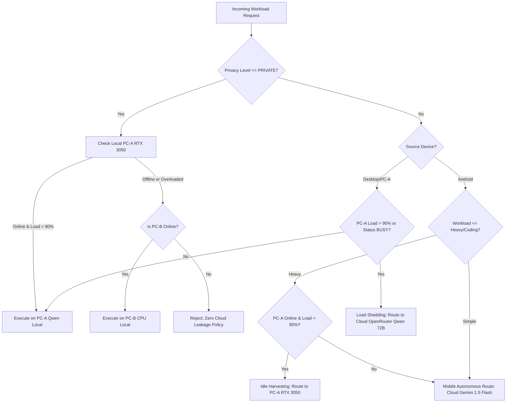

# AIVA — PRIMARY DEVELOPMENT MACHINE MIGRATION SPECIFICATION (PC-B $\rightarrow$ PC-A)

**Document Status:** Production Operational Blueprint  
**Target Topology:**  
- **PC-A (Primary Development + AI Power Node):** RTX 3050 Laptop GPU (8GB VRAM, CUDA), Intel i5 13th Gen, 16GB RAM  
- **PC-B (Secondary CPU Node):** Intel i5-1335U (12 cores), Intel Iris Xe Graphics (No CUDA), 16GB RAM  
- **Android (Mobile Client):** OnePlus 11 5G (Snapdragon 8 Gen 2, 16GB RAM)  
- **Cloud Coordination:** Render Cluster (`https://aiva-yitg.onrender.com`), Supabase DB, Upstash Redis  

---

## 1. PC-A Requirements (Primary Development + AI Power Node)

### 1.1 Development Tooling
- **Operating System:** Windows 11 64-bit (Build 22621+ recommended)
- **Git:** Git 2.52.0+ (Installed with Windows Credential Manager and symlink support)
- **Node.js:** Node.js v20.x or v22.x LTS (Node.js v25 also supported)
- **PNPM:** Version 9.0.0+ (`corepack enable && corepack prepare pnpm@latest --activate` or `npm install -g pnpm`)
- **Python:** Python 3.10 to 3.13 (User configuration: Python 3.13.7 64-bit)
- **Visual Studio C++ Build Tools:** Desktop development with C++ (Required for node-gyp native packages if rebuilding)
- **PowerShell:** PowerShell 7+ or Windows PowerShell 5.1

### 1.2 Runtime & Local Model Acceleration
- **GPU & Drivers:** NVIDIA GeForce RTX 3050 Laptop GPU (8GB VRAM) with Game Ready / Studio Driver 550+
- **NVIDIA CUDA Toolkit:** CUDA 12.1+ runtime libraries
- **Ollama:** Ollama for Windows v0.40.6+
- **Installed LLM:** `qwen3.5:latest` (or `qwen3:8b`)
- **PyTorch (CUDA Enabled):** PyTorch with CUDA 12.x support
  ```bash
  pip install torch torchvision torchaudio --index-url https://download.pytorch.org/whl/cu121
  ```
- **Local Speech & Vision Dependencies:**
  ```bash
  pip install kokoro-onnx sounddevice numpy soundfile psutil faster-whisper ctranslate2
  ```

---

## 2. PC-B Requirements (Secondary CPU Node)

PC-B remains fully supported as a secondary worker node and failover desktop workstation:
- **Operating System:** Windows 11 64-bit
- **Hardware Profile:** Intel Core i5-1335U, Intel Iris Xe Graphics, 16GB RAM
- **Role:** `CPU_LOCAL_NODE`
- **Services:**
  - Python runtime with CPU ONNX: `pip install kokoro-onnx psutil`
  - Local CPU TTS: `python apps/desktop/kokoro-service.py 5050`
  - Whisper STT: CPU int8 quantization
  - Secondary desktop client / fallback compute scheduler

---

## 3. Installation Sequence on PC-A

Execute this sequence on clean PC-A to mirror the production development environment:

### Step 1: Clone Repository
```powershell
git clone https://github.com/psking004/AIVA.git C:\Users\<Username>\AIVA
cd C:\Users\<Username>\AIVA
```

### Step 2: Install Global CLI Tools
```powershell
npm install -g pnpm tsx
```

### Step 3: Install Workspace Dependencies
```powershell
pnpm install
```

### Step 4: Generate Database Client & Build Packages
```powershell
pnpm --filter @aiva/backend run db:generate
pnpm --filter @aiva/backend run build
pnpm --filter @aiva/web run build
```

### Step 5: Setup Python Virtual Environment for Local AI
```powershell
python -m venv .venv
.\.venv\Scripts\Activate.ps1
pip install --upgrade pip
pip install psutil sounddevice numpy soundfile kokoro-onnx faster-whisper ctranslate2
```

### Step 6: Verify Ollama & Qwen
```powershell
ollama pull qwen3.5:latest
ollama list
```

---

## 4. Environment Variables Configuration

> [!CAUTION]
> Never commit actual credentials or copy secret files directly via unencrypted channels. Generate or populate keys manually on PC-A.

### 4.1 Backend Environment: `backend/.env`
```env
# Database & Cache (Shared Cloud Infrastructure)
DATABASE_URL=postgresql://<user>:<password>@<supabase-host>:6543/postgres?pgbouncer=true&statement_cache_size=0
SUPABASE_URL=https://<your-project>.supabase.co
SUPABASE_ANON_KEY=<your-supabase-anon-key>
REDIS_URL=rediss://default:<token>@<upstash-host>:6379
UPSTASH_REDIS_REST_URL=https://<upstash-host>
UPSTASH_REDIS_REST_TOKEN=<upstash-token>

# Security Secrets
JWT_SECRET=<unique-64-character-hex-secret>
JWT_REFRESH_SECRET=<unique-64-character-hex-secret>

# Model Routing Configuration
AIVA_ROUTING_STRATEGY=local-first
AIVA_CLOUD_PROVIDER=openrouter

# Local Node Ollama (PC-A GPU)
OLLAMA_BASE_URL=http://localhost:11434
OLLAMA_MODEL=qwen3.5:latest
OLLAMA_TIMEOUT_MS=60000

# Cloud Accelerators & Fallbacks
OPENROUTER_API_KEY=<your-openrouter-key>
OPENROUTER_MODEL=qwen/qwen-2.5-72b-instruct
GEMINI_API_KEY=<your-gemini-key>
GEMINI_MODEL=gemini-1.5-flash

# Server Configuration
PORT=4000
NODE_ENV=development
CORS_ORIGIN=http://localhost:3000
```

### 4.2 Web Frontend Environment: `apps/web/.env.local`
```env
AIVA_API_URL=http://localhost:4000
NEXT_PUBLIC_AIVA_API_URL=http://localhost:4000
ELEVENLABS_API_KEY=<your-elevenlabs-key>
```

---

## 5. Services Matrix: PC-A vs PC-B

| Service / Process | PC-A (Primary Development) | PC-B (Secondary Worker) | Port / Transport |
| :--- | :--- | :--- | :--- |
| **Ollama LLM Engine** | **ACTIVE** (`qwen3.5:latest` CUDA GPU) | Optional CPU Fallback | `http://localhost:11434` |
| **Kokoro TTS Service** | **ACTIVE** (Primary voice synthesis) | **ACTIVE** (Secondary CPU TTS) | `http://127.0.0.1:5050` |
| **Whisper STT Service** | **ACTIVE** (CUDA float16) | **ACTIVE** (CPU int8) | WASAPI loopback / service |
| **AIVA Backend Server** | **ACTIVE** (Primary API Gateway) | Inactive (or standby replica) | `http://localhost:4000` |
| **AIVA Web Dashboard** | **ACTIVE** (Next.js development) | Accessible via browser / LAN | `http://localhost:3000` |
| **Electron Desktop Shell**| **ACTIVE** (Primary operator UI) | Optional remote client | Desktop Window |
| **Coding Agent Engine** | **ACTIVE** (Local workspace edits) | Capability-gated remote worker| Internal IPC / REST |

---

## 6. Model Setup & Hardware Profiling

### 6.1 Ollama Qwen Verification
On PC-A, confirm the Ollama model is available and loaded into VRAM:
```powershell
ollama run qwen3.5:latest "Hello AIVA, identify your compute capabilities in 10 words."
```
Verify GPU utilization using `nvidia-smi`:
```powershell
nvidia-smi --query-gpu=utilization.gpu,memory.used,memory.total --format=csv
```

### 6.2 Dynamic Node Hardware Profiling
Run the profiler on PC-A:
```powershell
python scripts/hardware-profiler.py
```
**Expected Automated Output on PC-A:**
```json
{
  "node_id": "PC-A",
  "node_role": "AI_POWER_NODE",
  "hostname": "<PC-A-HOSTNAME>",
  "os": "Windows 11",
  "cpu": {
    "model": "13th Gen Intel Core i5...",
    "logical_cores": 12
  },
  "gpu": {
    "has_cuda": true,
    "device_count": 1,
    "device_name": "NVIDIA GeForce RTX 3050 Laptop GPU",
    "vram_mb": 8192
  },
  "models": [
    "qwen3.5:latest"
  ],
  "services": {
    "ollama_online": true,
    "ollama_latency_ms": 14.2
  },
  "recommendations": {
    "stt": "whisper-cuda-float16",
    "tts": "chatterbox-cuda",
    "llm": "qwen3.5:latest"
  }
}
```
This automatically creates [.aiva_node_identity.json](file:///c:/Users/bhara/AIVA/.aiva_node_identity.json) registering `device_pc_a_<hw_hash>`.

---

## 7. Distributed Routing & Load Behavior



---

## 8. Startup Sequence on PC-A

To launch AIVA cleanly on PC-A without service collisions:

### Terminal 1: Ollama Server
```powershell
ollama serve
```

### Terminal 2: Kokoro TTS Python Daemon
```powershell
.\.venv\Scripts\Activate.ps1
python apps/desktop/kokoro-service.py 5050
```

### Terminal 3: NestJS Backend API
```powershell
pnpm --filter @aiva/backend dev
```

### Terminal 4: Next.js Web Dashboard
```powershell
pnpm --filter @aiva/web dev
```

### Terminal 5: Desktop Electron Shell
```powershell
.\apps\desktop\node_modules\.bin\electron.cmd apps/desktop
```

---

## 9. Verification Commands on PC-A

Execute these verification commands on PC-A to guarantee operational parity:

```powershell
# 1. Typecheck entire codebase
pnpm --filter @aiva/backend run typecheck
pnpm --filter @aiva/web run typecheck

# 2. Compile backend production bundle
pnpm --filter @aiva/backend run build

# 3. Hardware Profiler Deterministic Check
python scripts/hardware-profiler.py

# 4. Distributed Fabric Dynamic Scheduling Suite
cd backend
npx tsx ..\scratch\test_distributed_fabric.ts

# 5. Remote Coding Agent & Rollback Safeguards
npx tsx ..\scratch\test_remote_coding.ts
npx tsx ..\scratch\test_real_rollback.ts

# 6. Policy Engine 4-Tier Security Suite
npx tsx ..\scratch\test_policy_engine.ts

# 7. End-to-End Three-Device Live Fabric Validation
npx tsx ..\scratch\run_three_device_live_fabric_validation.ts
```

---

## 10. Rollback & Failover Procedure

If PC-A encounters hardware maintenance, driver updates, or downtime:
1. **Cloud Autonomy:** The Render backend (`https://aiva-yitg.onrender.com`) and Android client continue operating without any dependency on PC-A. Android routes directly to Google Gemini.
2. **PC-B Workstation Standby:** PC-B can immediately boot the backend and web frontend from Git:
   ```powershell
   git pull origin main
   pnpm --filter @aiva/backend dev
   ```
   PC-B will automatically identify as `CPU_LOCAL_NODE` and process lightweight tasks, with heavy requests diverted to Cloud OpenRouter/Gemini.
3. **Zero State Drift:** No application data or credentials reside exclusively on PC-A. All task states, memory embeddings, and project entities are synchronized with Supabase and Upstash Redis.
