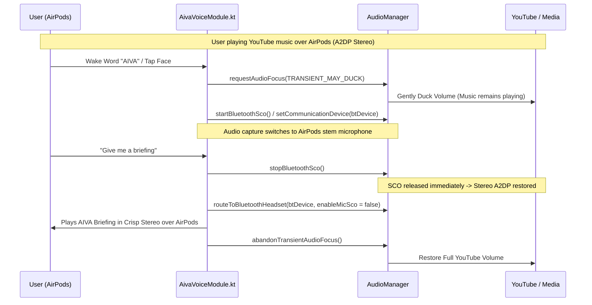

# AIVA Bluetooth & AirPods Audio Routing Specification

**Document Date:** 2026-11-15T19:10:00+05:30  
**Target Platform:** Android 14 / OriginOS 5 (iQOO Neo 10 / `com.aiva.personal.ai`)  
**Source Module:** [`apps/mobile/android/app/src/main/java/com/aiva/personal/ai/wakeword/AivaVoiceModule.kt`](file:///C:/Users/bhara/AIVA/apps/mobile/android/app/src/main/java/com/aiva/personal/ai/wakeword/AivaVoiceModule.kt)  

---

## 1. Bluetooth Audio Architecture

Android separates Bluetooth audio into distinct operational pipelines:
1. **A2DP / LE Audio (High-Bandwidth Stereo):** High fidelity ($44.1\text{ kHz} / 48\text{ kHz}$) output channel used for music, video, podcasts, and TTS playback.
2. **SCO (Synchronous Connection Oriented):** Low-bandwidth ($8\text{ kHz} / 16\text{ kHz}$) bi-directional voice communication channel used during phone calls and Bluetooth headset microphone capture.

### The AIVA Bluetooth Coexistence Rule

> [!IMPORTANT]
> AIVA must never leave Bluetooth SCO permanently open. Permanent SCO locks Android's audio server into muffled mono mode, degrading or muting background YouTube, Spotify, and Instagram audio.

---

## 2. Dynamic Routing Lifecycle

---

## 3. Hot-Plug Watchdog & Safety Features

1. **`AudioDeviceCallback`:** Dynamically tracks Bluetooth devices connecting or disconnecting in real time.
2. **Hot Disconnect Fallback:** If AirPods disconnect mid-sentence, output seamlessly falls back to the phone loudspeaker without crashing or dropping background wake-word detection.
3. **Incoming Call Hand-off:** Yields immediately when `audioManager.mode == AudioManager.MODE_IN_CALL`.
4. **Silent & Vibrate Mode:** Voice replies are muted if the device ringer is set to `RINGER_MODE_SILENT` unless explicitly triggered by touch.

