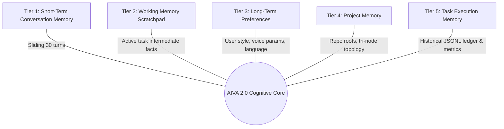

# AIVA 2.0 Multi-Tier Memory Architecture

**Module:** `packages/memory/memory_manager.py`  
**Storage Directory:** `backend/data/memory/`  

---

## 1. 5 Cognitive Memory Tiers

### Tier Specifications:
1. **Short-Term Memory:** Retains the 30 most recent conversational turns with millisecond timestamps and participant roles.
2. **Working Memory:** Dynamic key-value scratchpad for multi-step task execution. Flushed upon task completion.
3. **Long-Term Preferences:** Persisted to `preferences.json`. Stores communication style (`warm_direct_intelligent`), voice profile (`af_bella` @ 1.05), and language preferences (`["en-US", "ta-IN", "tanglish"]`).
4. **Project Memory:** Persisted to `project_memory.json`. Stores repository roots, hardware node topology, and architectural decisions.
5. **Task Execution Memory:** Retains complete task history in `task_ledger.jsonl`.

