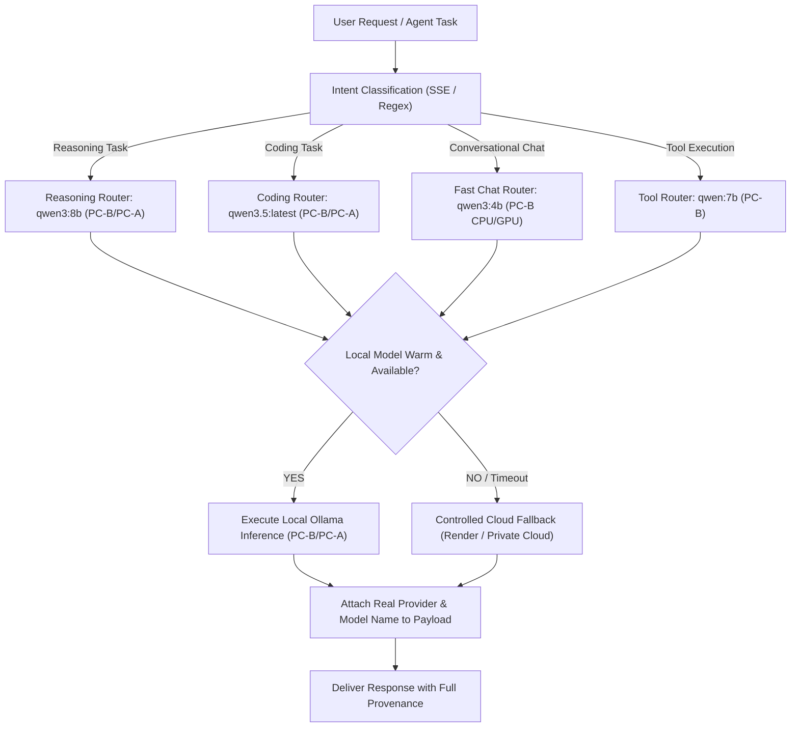

# AIVA Model Inventory & Intelligent Router Specification

**Inventory Date:** 2026-11-15T19:09:30+05:30  
**Host:** PC-B (Intel Core i7-13700HX / i5 Workstation)  
**Target Node:** PC-A (RTX 3050 GPU / 10.16.177.194)  

---

## 1. Physical Model Inventory (PC-B Local Ollama)

| Ollama Model Tag | Model ID | Disk Size | Target Capability | Measured State |
| :--- | :--- | :---: | :--- | :---: |
| `qwen3:4b` | `359d7dd4bcda` | 2.5 GB | Fast Chat & Low-Latency Dialogue | Verified on Disk (CPU execution) |
| `qwen:7b` | `2091ee8c8d8f` | 4.5 GB | General Reasoning & Tools | Verified on Disk |
| `llama3:latest` | `365c0bd3c000` | 4.7 GB | Conversational Chat | Verified on Disk |
| `qwen3:8b` | `500a1f067a9f` | 5.2 GB | Deep Reasoning | Verified on Disk |
| `qwen3.5:latest` | `6488c96fa5fa` | 6.6 GB | Coding & Complex Plan Generation | Verified on Disk |
| `sorc/qwen3.5-claude-4.6-opus-q4` | `d9824ed281ee` | 6.6 GB | High-Fidelity Verification Subagent | Verified on Disk |

---

## 2. Intelligent Routing Policy

The Model Router dynamically selects the optimal node and engine based on capability requirements, latency limits, and resource availability:

### Capability Mappings

1. **Reasoning Tasks (`REASONING`):**
   - *Target:* `deepseek-r1:8b` (preferred) $\rightarrow$ Local Fallback: `qwen3:8b`.
   - *Node Preference:* PC-A (if GPU active) $\rightarrow$ PC-B.
2. **Coding Tasks (`CODING`):**
   - *Target:* `qwen2.5-coder:7b` (preferred) $\rightarrow$ Local Fallback: `qwen3.5:latest`.
   - *Node Preference:* PC-A $\rightarrow$ PC-B.
3. **Conversational Fast Chat (`FAST_CHAT`):**
   - *Target:* `llama3.2:3b` (preferred) $\rightarrow$ Local Fallback: `qwen3:4b`.
   - *Node Preference:* Local PC-B (minimal loading footprint, sub-second TTFT).
4. **Tool Use & System Commands (`TOOL_USE`):**
   - *Target:* `glm4:9b` (preferred) $\rightarrow$ Local Fallback: `qwen:7b`.
   - *Node Preference:* PC-B (direct orchestrator access).

---

## 3. Provenance & Transparency Enforcements

- **No Silent Cloud Routing:** Responses generated locally must explicitly state `provider: "ollama"`, `node: "PC-B" | "PC-A"`, and `model: "<model_tag>"`.
- **Cloud Fallback Transparency:** When falling back to Render or external cloud APIs due to memory or latency limits, the response header reports `provider: "cloud_fallback"`.

