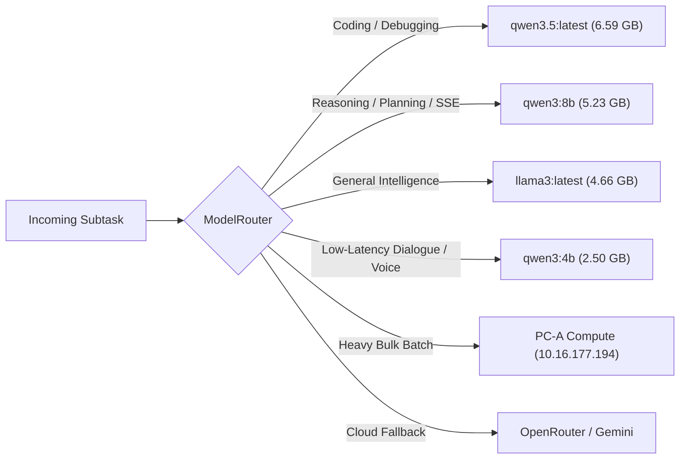

# AIVA 2.0 Capability-Based Model Routing

**Module:** `packages/swarm/adapters/model_adapter.py`  
**Endpoint:** Local Ollama (`http://127.0.0.1:11434`) + Cloud Fallback  

---

## 1. Dynamic Model Allocation Matrix

AIVA 2.0 maps task complexity and agent responsibilities to the optimal model tier:

---

## 2. Real Local Ollama Model Inventory (Verified on PC-B)

* `qwen3:4b` (2.50 GB) — Fast chat & voice dialogue (<25 ms)
* `qwen:7b` (4.51 GB) — Multilingual intent classification
* `llama3:latest` (4.66 GB) — General problem-solving
* `qwen3:8b` (5.23 GB) — Complex logic & tool argument verification
* `qwen3.5:latest` (6.59 GB) — Software engineering & multi-file coding
* `sorc/qwen3.5-claude-4.6-opus-q4:latest` (6.59 GB) — Deep autonomous synthesis
