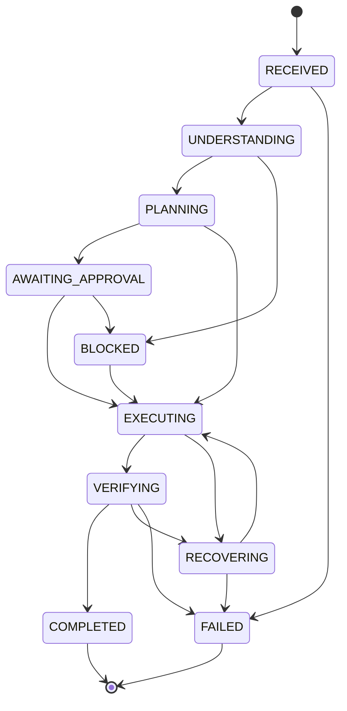

# AIVA 2.0 Task Execution Engine & Lifecycle Persistence

**Module:** `packages/swarm/lifecycle/task_lifecycle.py`  
**Ledger Storage:** `backend/data/tasks/task_ledger.jsonl`  

---

## 1. 10-State Lifecycle State Machine

AIVA 2.0 tasks transition through a strictly governed finite state machine:

### 1.1 State Definitions
* **`RECEIVED`**: Ingestion of raw user voice or text instruction. Unique task UUID assigned.
* **`UNDERSTANDING`**: Intent parsing, entity extraction, and conversational context enrichment.
* **`PLANNING`**: Strategic DAG formulation by SSE, subtask assignment, and resource allocation.
* **`AWAITING_APPROVAL`**: Permission gate if task entails high-risk actions (e.g. destructive edits).
* **`EXECUTING`**: Active subtask execution across specialist swarm agents and tools.
* **`VERIFYING`**: Independent reviewer audits outputs against criteria.
* **`COMPLETED`**: Final success state; artifacts persisted, user briefed.
* **`BLOCKED`**: Execution paused awaiting missing credentials, hardware, or approval.
* **`RECOVERING`**: Automatic crash recovery upon system reboot or unexpected interruption.
* **`FAILED`**: Terminal failure state with full diagnostic error trace.

---

## 2. Persistence & Durability Protocol

1. **Atomic Append-Only JSONL Ledger:** Every state transition, metadata update, and artifact creation is committed to `backend/data/tasks/task_ledger.jsonl` using `os.fsync`.
2. **Reboot Crash Recovery:** Upon orchestrator initialization, `TaskLifecycleEngine.recover_interrupted_tasks()` scans for orphaned tasks in `EXECUTING` or `PLANNING`, promotes them to `RECOVERING`, increments retry counters, and resumes pipeline execution.
