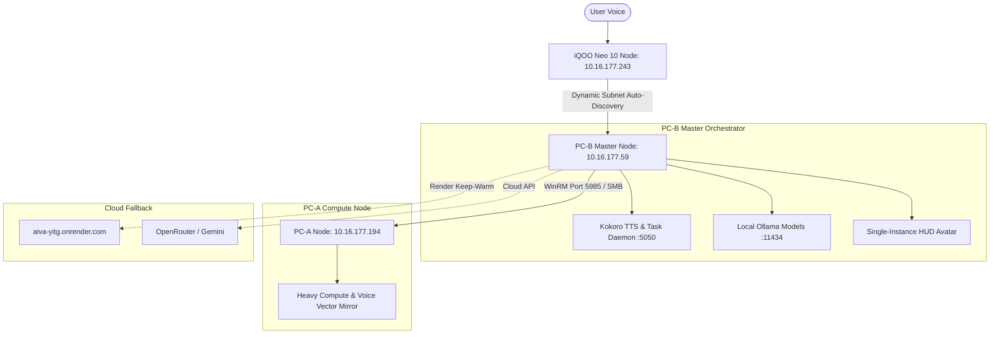

# AIVA 2.0 Tri-Node Distributed Execution Fabric

**Topology:** Sovereign Tri-Node Architecture  
**Network Subnet:** `10.16.177.x`  

---

## 1. Node Topology & Responsibilities

### 1.1 Verified Physical Node States
* **PC-B:** Master host (`10.16.177.59`). Port 5050 active (`status: ready`). Port 11434 active with 7 local models. Single-instance Electron HUD lock active.
* **PC-A:** Remote compute (`10.16.177.194`). TCP port 5985 verified OPEN.
* **iQOO Neo 10 Mobile:** Connected over USB (`10BF6B1T1C001BS`) and Wi-Fi (`10.16.177.243:5555`). Background wake word service active without media audio focus hijacking.

