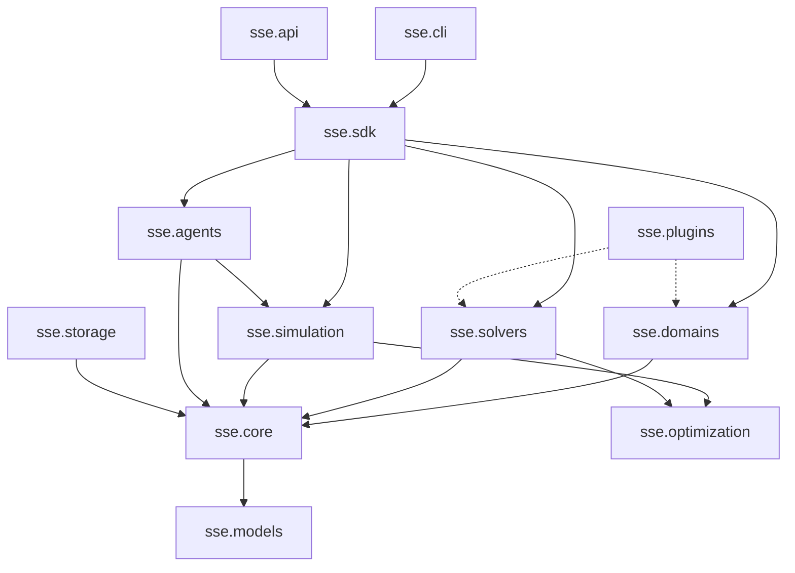

# System Architecture Specification
## Strategic Systems Engine (SSE)

**Document Identifier:** SSE-ARCH-001  
**Version:** 1.0.0  
**Pattern:** Extensible Modular Monolith  

---

### 1. Architectural Overview

The Strategic Systems Engine is structured as a **modular monolith**. This ensures zero-network-overhead function calls, strong static and runtime type guarantees, atomic data structures, and straightforward testing while enforcing strict directional dependency boundaries that allow computational tasks to be scaled out to worker pools when required.

---

### 2. Module Responsibilities and Layering

#### 2.1 Layer 0: Fundamental Contracts & Models
- **`sse.models`:** Legacy and lightweight finite normal-form game representations (`FiniteNormalFormGame`, `Player`, `GameValidationError`). Kept strictly stable for zero-breaking-change backward compatibility.
- **`sse.core.types`:** Foundational enumerations (`GameFamily`, `SolverStatus`, `PlayerType`) and atomic types (`PlayerId`, `ActionId`, `Probability`, `Payoff`, `NumericPrecision`).
- **`sse.core.actions`:** Space abstractions including `DiscreteActionSpace`, `ContinuousActionSpace`, and `ProductActionSpace`.
- **`sse.core.strategies`:** `PureStrategy`, `MixedStrategy`, `StrategyProfile`, and `BehavioralStrategy` contracts with probability invariant enforcement.
- **`sse.core.payoffs`:** Tensor matrix indexing, linear functional payoffs, and zero-sum symmetric checks.
- **`sse.core.information`:** `InformationSet`, `InformationStructure`, and Bayesian `BeliefDistribution` updating.
- **`sse.core.games`:** Generalized game representations: `ExtensiveFormGame`, `BayesianGame`, `CooperativeGame`, `RepeatedGame`, `EvolutionaryGame`, `StochasticGame`, `StackelbergGame`, `CongestionGame`, `PotentialGame`.
- **`sse.core.validation`:** Systematic verification of mathematical invariants.
- **`sse.core.serialization`:** Versioned JSON serializers and deserializers.

#### 2.2 Layer 1: Numerical Optimization & Computational Core
- **`sse.optimization.linear`:** Primal-dual LP and zero-sum minimax solving with SciPy HiGHS backend and pure-Python simplex fallback.
- **`sse.optimization.nonlinear`:** SLSQP / Nelder-Mead nonlinear solver with gradient descent fallbacks.
- **`sse.optimization.multi_objective`:** Pareto efficiency identification and frontier generation.

#### 2.3 Layer 2: Mathematical Solvers
- **`sse.solvers.base`:** Solver result protocols (`SolverResult`, `SolverMetadata`).
- **`sse.solvers.registry`:** Global solver discovery and lifecycle management.
- **`sse.solvers.pure_nash`:** Complete profile enumeration and unilateral deviation verification.
- **`sse.solvers.mixed_nash`:** 2-player support enumeration algorithm for exact mixed Nash equilibria.
- **`sse.solvers.dominant`:** Weak/strict dominance detection and iterated elimination (IEDS).
- **`sse.solvers.minimax`:** Two-player zero-sum value computation via linear programming duality.
- **`sse.solvers.backward_induction`:** Subgame-perfect backward induction on extensive-form game trees.
- **`sse.solvers.cooperative`:** Exact Shapley value marginal contribution and Core stability computation.
- **`sse.solvers.correlated`:** Correlated equilibrium LP formulation maximizing social welfare.
- **`sse.solvers.evolutionary`:** Continuous replicator differential equations and ESS verification.
- **`sse.solvers.stackelberg`:** Bilevel leader-follower commitment optimization.
- **`sse.solvers.regret`:** External regret matching and minimization routines.

#### 2.4 Layer 3: Simulation & Multi-Agent Intelligence
- **`sse.simulation.engine`:** Execution loop for single-shot, repeated, and Monte Carlo runs.
- **`sse.simulation.experiment`:** Lifecycle management, parameter tracking, and result comparison.
- **`sse.simulation.sensitivity`:** One-at-a-time (OAT) parameter sensitivity analysis.
- **`sse.agents.base`:** Agent ABC, configuration, observation, and policy update hooks.
- **`sse.agents.strategies`:** Classical baselines (TitForTat, GrimTrigger, Random, Fixed).
- **`sse.agents.learning`:** Q-learning, Fictitious Play, Regret Matching, Replicator dynamics.
- **`sse.agents.tournament`:** Round-robin tournament engine and ranking matrix generator.

#### 2.5 Layer 4: Multi-Domain Extensions
Self-contained domain modules providing high-level business/engineering scenarios that translate into core game instances:
- **`sse.domains.cybersecurity`:** Network target defense, APT defense, security investment.
- **`sse.domains.economics`:** Cournot oligopoly, Bertrand pricing, auctions, public goods.
- **`sse.domains.business`:** Price wars, market entry deterrence, capacity investment.
- **`sse.domains.logistics`:** Congestion routing, shared facility allocation, freight scheduling.
- **`sse.domains.transportation`:** Braess's paradox, commute route choice, signal coordination.
- **`sse.domains.social`:** Voting paradoxes, legislative coalitions, Hawk-Dove contests.
- **`sse.domains.autonomous`:** Robot intersection coordination, distributed spectrum allocation.

#### 2.6 Layer 5: Developer Tooling & Integration
- **`sse.storage.filesystem`:** JSON-based persistent storage for games, runs, and policies.
- **`sse.storage.repository`:** Typed CRUD repository wrappers.
- **`sse.plugins.base` & `sse.plugins.loader`:** Dynamic runtime extension system.
- **`sse.sdk.client`:** Unified developer interface.
- **`sse.api`:** FastAPI application exposing REST endpoints.
- **`sse.cli`:** Command-line tooling (`validate`, `solve`, `simulate`, `domains`).

---

### 3. Invariant Enforcement & Error Handling

All public methods validate inputs at their boundary. Invalid states raise specific, non-silent exceptions:
- `GameValidationError` / `GameContractError`: Structural or dimensional invalidity.
- `ValueError` / `TypeError`: Argument invalidity.
- `RuntimeError`: Numerical solver non-convergence or timeout.

No solver or simulation method may silently ignore exceptions, emit dummy values in place of valid calculations, or disable convergence checks.

