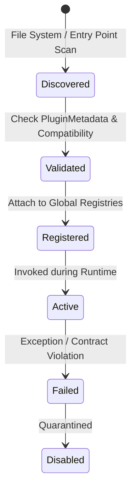

# Plugin Architecture Specification
## Strategic Systems Engine (SSE)

**Document Identifier:** SSE-PLUG-001  
**Version:** 1.0.0  

---

### 1. Plugin System Purpose

SSE provides a decoupled extension mechanism enabling third-party developers, researchers, and domain specialists to register new:
1. **Mathematical Solvers:** Integration of external optimization tools, MILP routines, or specialized equilibrium algorithms.
2. **Game Families:** New mathematical representations (e.g., hypergames, quantum games).
3. **Domain Modules:** Application-specific game generators, real-world data loaders, and scenario libraries.
4. **Adaptive Agents:** Custom neural network or rule-based game players.
5. **Storage Adapters:** Connectors for PostgreSQL, Redis, S3, or analytical data warehouses.

---

### 2. Plugin Contract Lifecycle

1. **Discovery:** Discovered via Python package entry points (`sse.plugins`) or directory loading.
2. **Metadata Inspection:** Each plugin provides immutable `PluginMetadata` including name, semantic version, author, description, and engine compatibility expression.
3. **Validation:** The plugin's `validate()` hook tests environmental requirements and structural completeness.
4. **Registration:** `register()` executes registrations into `sse.solvers.registry.registry`, `sse.domains.DomainRegistry`, etc.
5. **Isolation:** Plugins operate within standardized try/except boundaries with explicit error tracing.

